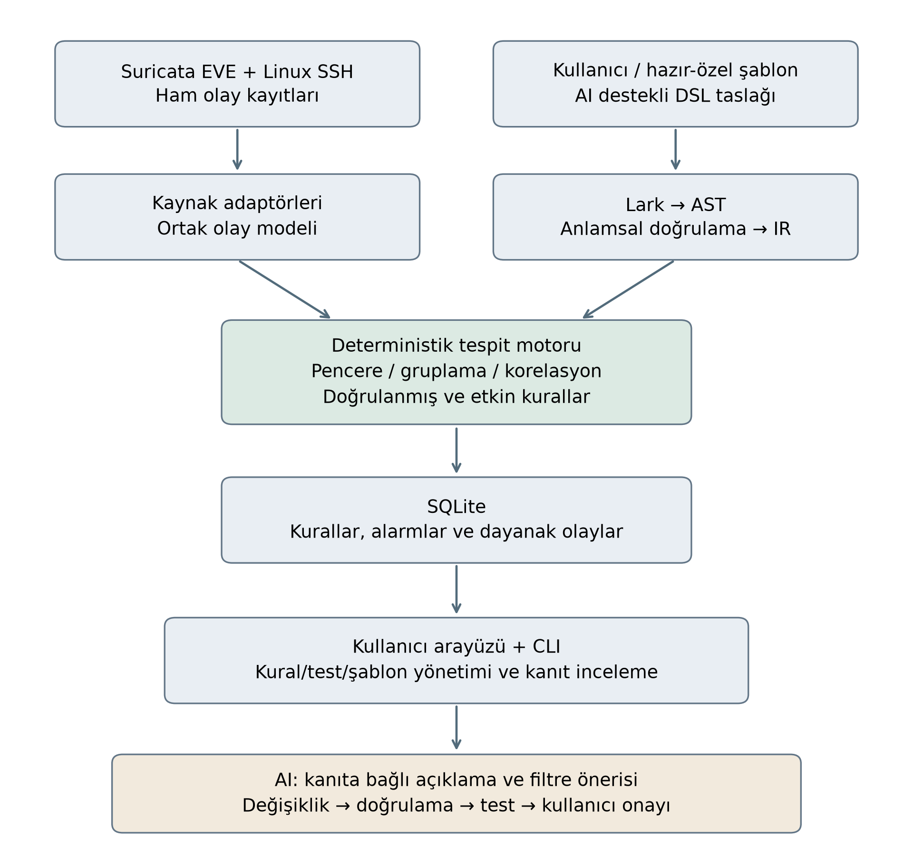

# Önerilen sistem mimarisi

## Olay hattı

Suricata EVE `alert` ve `flow` ile Linux SSH kayıtları kaynak adaptörleriyle normalize edilir. Ortak olay modelinde kaynak referansı, zaman, IP/port/protokol ve mevcut uygulama alanları korunur. Eksik alanlar tahmin edilmez. Port çeşitliliği senaryosu için bağlantı görünürlüğü sağlayan `flow` kayıtları kullanılır.

## Kural hattı

Kullanıcı, hazır/özel şablon veya AI taslağından gelen DSL metni Lark ile ayrıştırılır. Sözdizim ağacından AST üretilir; kaynak, alan, eşik, süre ve gruplama denetimleri sonrasında IR oluşturulur. Lark ayrıştırmadan, tespit motoru sayım ve korelasyondan sorumludur.

## Değerlendirme ve kayıt

Motor her kural ve grup için zaman penceresini değerlendirir. Canlı değerlendirmede pencere alma zamanına göre `(t-W, t]` olarak planlanmıştır; kaynak zamanı kanıt için ayrıca saklanır. Yeniden oynatımda kontrollü saat kullanılarak aynı sınırlar sınanacaktır. Tekrar kayıt, geç gelen kayıt, aynı zamanlı olay, yeniden başlatma ve alarm tekrarının davranışı dil/motor sözleşmesinde tanımlanacaktır.

Alarmlar ilgili kural ve dayanak olaylarla SQLite içinde saklanır. IP ortaklığı ilişkilendirme anahtarıdır; tek başına kimlik veya nedensellik kanıtı değildir.

## Arayüz ve AI

Arayüz kural/şablon düzenleme, test etme ve alarmdan dayanak kayıtlara erişme akışlarını sunar. AI; desteklenen gramer/alanlarla DSL taslağı oluşturur, seçili logları açıklar ve yanlış pozitifleri azaltmak için filtre değişiklikleri önerir.

Öneri → doğrulama → eski/yeni kuralı aynı veri üzerinde test → kullanıcı onayı akışı uygulanır. AI kendiliğinden alarm silmez. Açıklamalar kayıt kimliklerine bağlanır; log metinleri talimat olarak kullanılmaz. AI hizmeti kullanılamadığında elle kural yönetimi ve çekirdek tespit çalışmaya devam etmelidir.

Bu belge uygulanacak tasarımı anlatır. Bileşenlerin tamamlandığı iddiası taşımaz.
